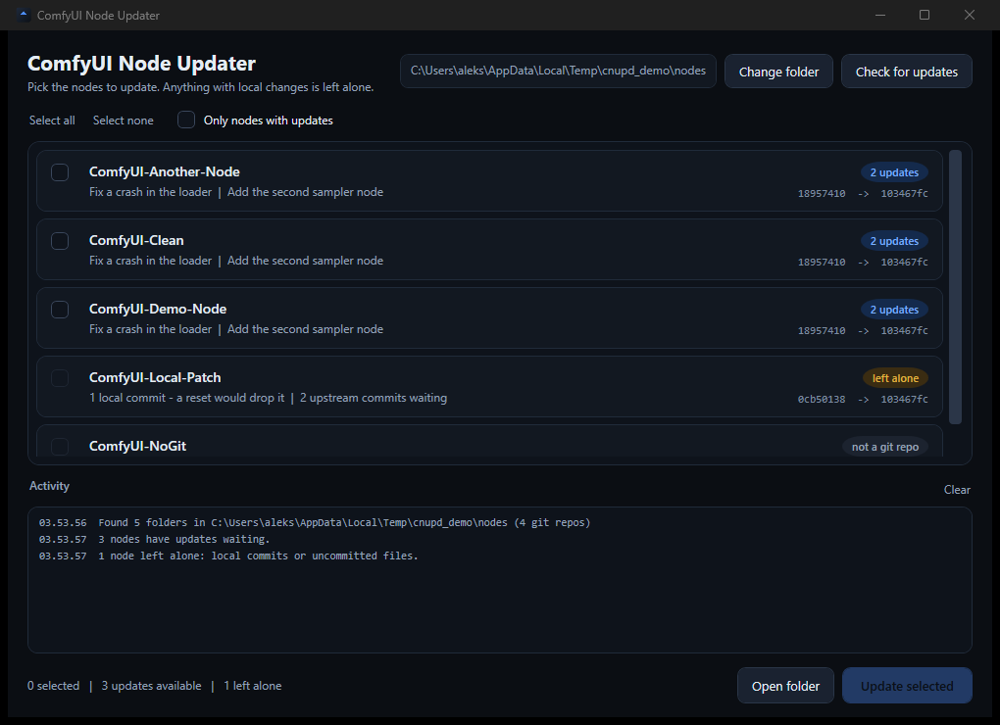
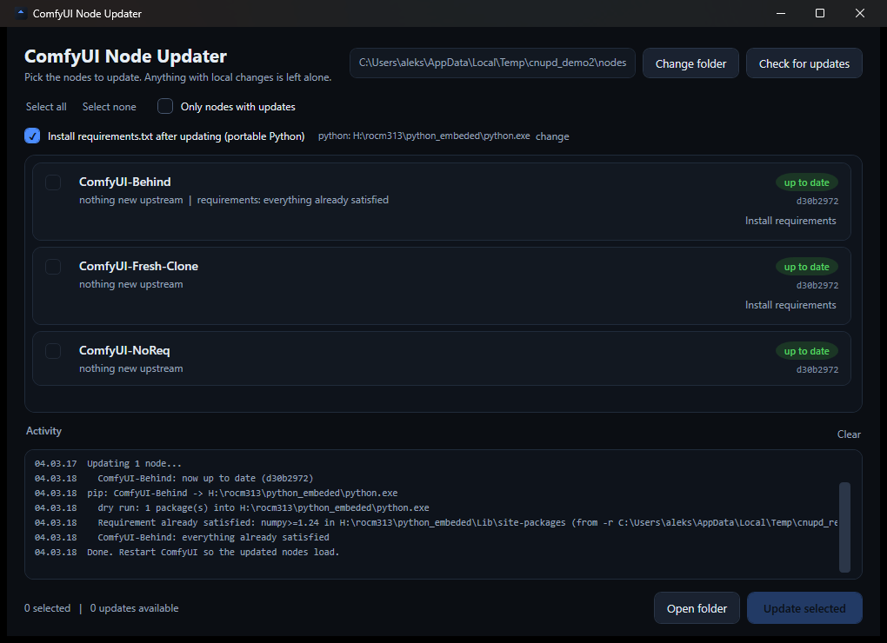

# ComfyUI Node Updater

A small Windows app for ComfyUI's `custom_nodes` folder: it tells you which nodes have upstream
commits waiting, and updates **only the ones you tick**. No more `git reset --hard` on everything,
and nothing with local changes ever gets touched.



## Why

Updating custom nodes is usually one of three things: a bulk script that resets every repo (and
silently throws away local commits or edits), a Manager "update all" that gives you no say, or a
terminal per folder. This app shows what is actually behind, lets you pick, and refuses to destroy
work.

## Features

- **Per-node view**: current commit → upstream commit, how many commits behind, and the subjects of
  up to three of them.
- **Tick what you want**, then one button updates exactly those. `Select all` / `Select none` and an
  `Only nodes with updates` filter.
- **Local work is protected**: a local commit or an uncommitted tracked file marks the row
  `left alone` (amber) and its checkbox is disabled — a reset would destroy it, so the app won't.
- **Requirements installer** (optional): installs a node's `requirements.txt` into your ComfyUI
  Python, either per node or automatically after updates. It refuses to replace the ROCm torch/triton
  build (details below).
- Fetches six repos at a time, so checking ~25 nodes takes seconds.
- Remembers your `custom_nodes` folder, window size and options.
- Activity log with every git and pip step.

## Requirements

- Windows 10/11
- git on `PATH`
- .NET 8 Desktop Runtime for the release build (already present on most Windows installs with .NET;
  otherwise [download it](https://dotnet.microsoft.com/download/dotnet/8.0)). Build it self-contained
  if you need a machine without it.

## Getting it

- **Download**: grab `ComfyNodeUpdater.exe` from [Releases](../../releases) — one file, no installer.
- **Build**: see [Building](#building).

## Using it

1. Start `ComfyNodeUpdater.exe`. It checks the remembered folder; `Change folder` picks your
   `custom_nodes` directory (e.g. `H:\rocm313\ComfyUI\custom_nodes`).
2. Blue rows have updates. Tick the ones you want and press **Update selected**.
3. Restart ComfyUI so the new node code loads.

A node you just cloned is already at upstream's commit, so it never shows as updateable. That's fine
— its requirements still matter:

### Fresh clones and `requirements.txt`

Every row with a `requirements.txt` shows an **Install requirements** link, even when the node is
`up to date`:



- **By hand**: click the link — it shows what would be installed and asks first.
- **Automatically**: tick `Install requirements.txt after updating (portable Python)`; every node
  that gets updated installs right after the reset. The target interpreter is on the same line
  (`python: …\python_embeded\python.exe`), `change` picks another `python.exe`.

### It can't break your ROCm build

A blind `pip install -r requirements.txt` can pull CUDA wheels over a ROCm environment. This app:

1. Drops `torch`, `torchvision`, `torchaudio`, `triton`, `triton-windows`, `pytorch-triton`,
   `pytorch-triton-rocm`, `xformers`, `flash-attn`, `tensorrt`, `onnxruntime-gpu` from the file, and
   drops pip option lines (`-r`, `--index-url`, `-e`) so they can't come back in.
2. Runs `pip install --dry-run --report` first; if a *dependency* would install any blocked package,
   it refuses and names it before writing anything.
3. Only then does the real install run, with output streaming into the Activity log.

## What it won't do

- No `git clean`, no file deletion, no touching untracked files.
- No reset on a node with local commits or uncommitted tracked files.
- No network calls of its own: only the git fetch/pull of the folder you point it at, and pip when
  you ask it to install something.

The update itself is `git reset --hard <upstream>` — on a clean node, the same thing `git pull` would
give you.

## Command line

Useful for scripts and for checking without the window:

```text
ComfyNodeUpdater.exe --self-test report.txt            # builds throwaway repos, 18 checks, exit 0/1
ComfyNodeUpdater.exe --check <custom_nodes> report.txt # fetch-only scan, writes report.txt (+ .json)
ComfyNodeUpdater.exe --pip <node folder> [report.txt] [python.exe]
ComfyNodeUpdater.exe --folder <custom_nodes>           # open the window on that folder, without saving it
ComfyNodeUpdater.exe --version
```

`--check` never updates anything. `--pip` follows the same filter and dry-run rules as the window.

## Building

Source is C# / .NET 8 / WPF, no NuGet packages.

```powershell
git clone https://github.com/aksugat/comfyui-node-updater
cd comfyui-node-updater
./build.ps1            # -> dist\ComfyNodeUpdater.exe
```

or by hand:

```powershell
dotnet publish src -c Release -r win-x64 --self-contained false `
  -p:PublishSingleFile=true -p:IncludeNativeLibrariesForSelfExtract=true -o dist
```

For a machine without .NET, add `--self-contained true` (a ~150 MB single file).

`./build.ps1 -SelfContained` does that.

## Layout

| Path | What |
|---|---|
| `src/MainWindow.xaml(.cs)` | the window |
| `src/NodeChecker.cs` | scan, fetch, behind/ahead, the local-work guard |
| `src/Git.cs` | the git runner (no console window, no prompts) |
| `src/PipInstaller.cs` | requirements filter, dry-run guard, install |
| `src/Models.cs` | one row's state and text |
| `src/Settings.cs` | remembered folder, python, options |
| `src/SelfTest.cs` | throwaway-repo checks used by `--self-test` and CI |
| `src/Headless.cs` | `--check` mode |

## Notes

- `.NET 8` is required at runtime for the release build; the self-contained build is not.
- The app only reads git state; it does not clone, delete or add nodes.
- Tested on Windows 11 with ComfyUI 0.44 and ROCm, against throwaway repositories for the guard and
  end-to-end through the window for the update path.

## License

MIT — see [LICENSE](LICENSE).
