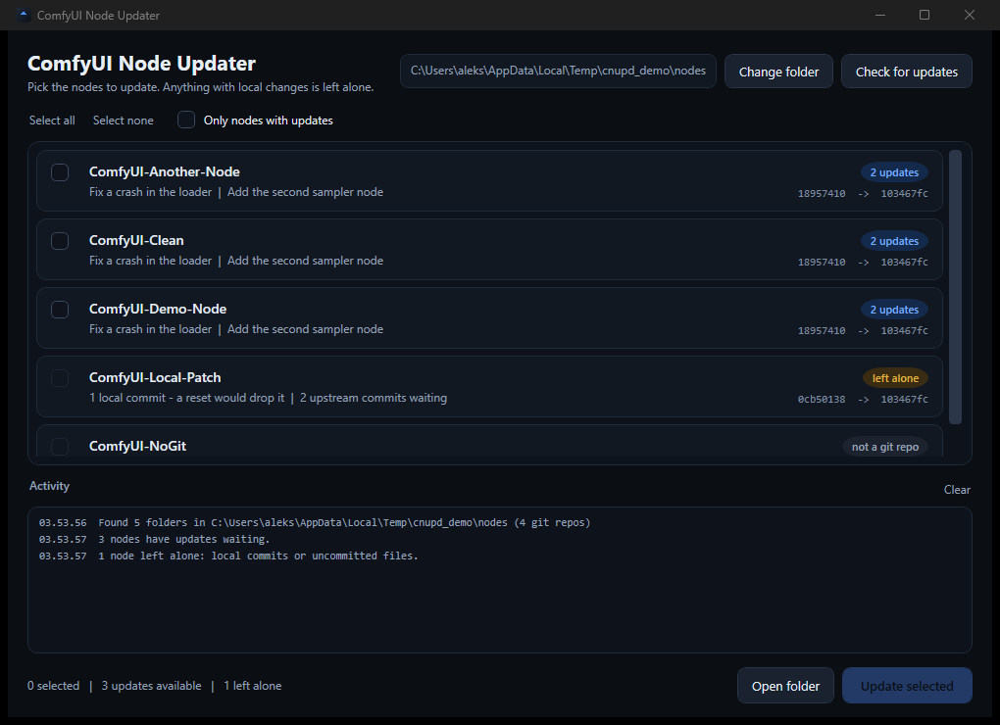
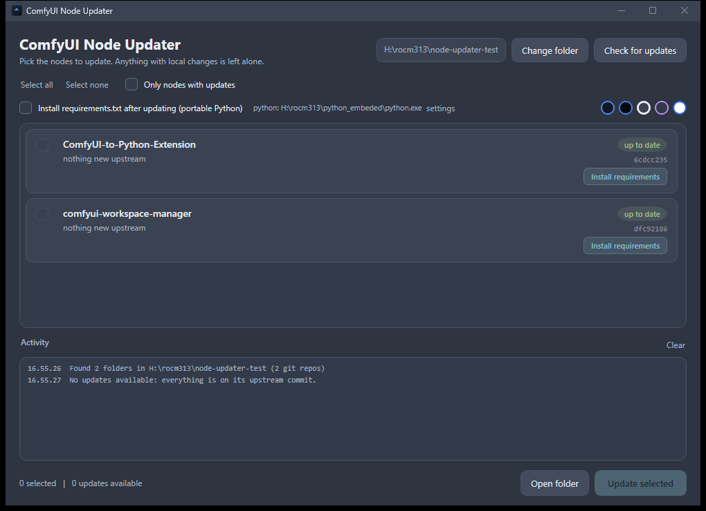
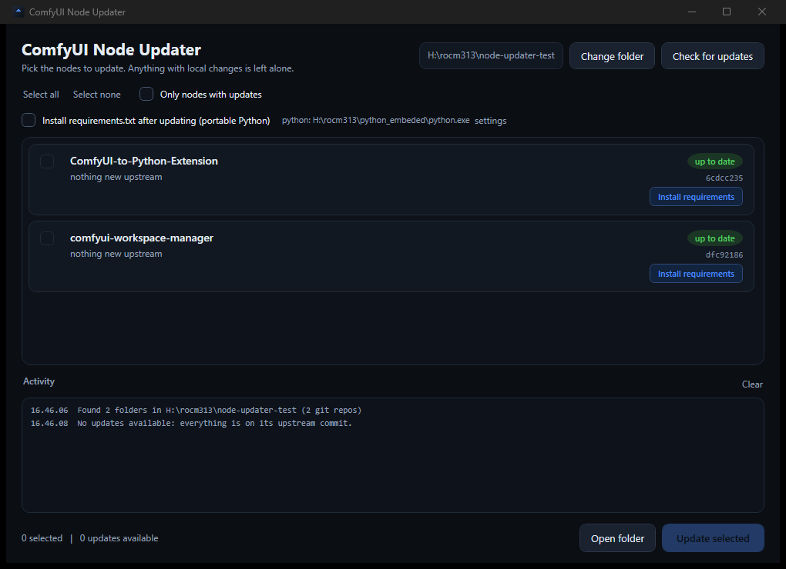
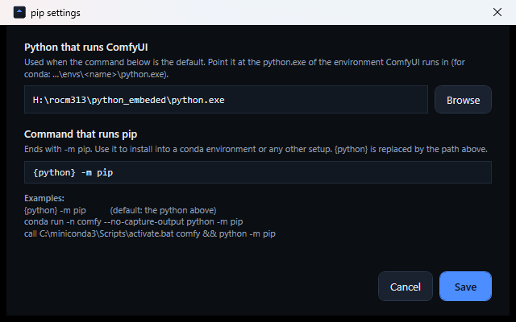

# ComfyUI Node Updater
[](README.md)
[](README_SV.md)

Ett litet Windows-program för ComfyUI's `custom_nodes` mapp: Detta program berättar för dig vilka noder inväntar uppdaterade ("upstream") commits.
Programmet uppdaterar **endast de noder du klickar in på** - inga fler `git reset --hard` på allt.
Inget lokalt kommer att ändras.



## Anledning
När du uppdaterar `custom nodes` så är det oftast om 3 saker:
ett så kallat "bulk" skript, som resettar alla repon (och tyst kastar lokala commits och ändringar), eller en Wizard som uppdaterar allt som ger dig inget val att säga ja eller nej - eller, en terminal per mapp. Det här programmet siktar på att lösa dessa problem. Det visar dig vad som händer bakom kulliserna, låter dig välja saker och vägrar ha sönder ditt arbete.

## Funktioner

- **Pär-nod vy**: aktuella comitten → "upstream" commit, hur många commits som ligger bakom, och subjekten från upp till tre av dem.
- **Klicka i på vad du vill**, endast uppdaterar dom i-klickade (`Select all` / `Select none`) och ett (`Only nodes with updates`) filter.
- **Lokalt arbete är skyddat**: en såkallad lokal commit eller en "uncommitted" spårad fil markerar raden `left alone` (amber) och dess checkbox är avstängd - en reset skulle förstöra den, det här programmet kommer inte förstöra den dock.
- **Requirements Wizard** (Frivillig): installerar en nods `requirements.txt` fil i din ComfyUI
  Python, antingen pär nod eller automatiskt efter uppdateringar. Den kommer inte att replejsa ROCm torch/triton builds (detaljer nedan).
- Drar 6 reporn åt gången, så checkar ~25 noder tar bara några sekunder.
- kommer ihåg din `custom_nodes` mapp, fönster size och andra inställningar/flaggor.
- **Fem Teman**, är ändratt live från de 3 punkterna i toolbaren: Midnight, OLED, Nord, Dracula, Latte.
- Aktivitets log med varje `git` & `pip` steg.

## Teman


Välj en av 5 punkter på den högra sidan av toolbaren; fönstret och titeln ändras omedelbart och valet kommer bli ihågkommet.
temat "Midnight" är det defaulta temat, OLED är på för 100% mörka rum och Latte är den ljusa.

## Beroenden

- Windows 10/11
- `git` i `PATH`
- .NET 8 Desktop Runtime för release-builden (finns redan på de flesta Windows-installationer med .NET;
  annars [ladda ner det här](https://dotnet.microsoft.com/download/dotnet/8.0)). Bygga den fristående
  ("*self-contained*") ifall du behöver köra det på en maskin som inte har detta.

## Kom igång

- **Ladda ner**: hämta `ComfyNodeUpdater.exe` från [Releases](../../releases) - en enda fil, inget installationsprogram.
- **Bygga**: se [Bygga](#Bygga).

## Hur / Användning

1. Starta `ComfyNodeUpdater.exe`. Den kontrollerar den senast ihågkomna mappen; med `Change folder` väljer du din
   `custom_nodes`-mapp (t.ex. `H:\rocm313\ComfyUI\custom_nodes`).
2. Blå rader har uppdateringar. Bocka i de du vill ha och tryck på **Update selected**.
3. Starta om ComfyUI så att den nya nodkoden laddas in.

En nod du nyss klonat ligger redan på uppströms (*upstream*) senaste commit, så den visas aldrig som uppdateringsbar. Det gör inget, dess beroenden (*requirements*) spelar fortfarande roll:

### Färska kloner och `requirements.txt`

Varje rad med en `requirements.txt` visar en **Install requirements**-knapp, även när noden är
`up to date`:



- **Manuellt**: klicka på knappen - den visar vad som skulle installeras och frågar först.
- **Automatiskt**: bocka i `Install requirements.txt after updating (portable Python)`; varje nod
  som uppdateras installeras direkt efter återställningen. Måletolkens sökväg står på samma rad
  (`python: …\python_embeded\python.exe`); `settings` öppnar pip-inställningarna.

### Conda eller någon annan miljö

`settings` tar ett kommando som slutar med `-m pip`, så installationen kan ske i vilken miljö som helst där ComfyUI körs:



```text
{python} -m pip                                          (standard: python-sökvägen ovan)
conda run -n comfy --no-capture-output python -m pip
call C:\miniconda3\Scripts\activate.bat comfy && python -m pip
```

`{python}` ersätts med sökvägen i det första fältet, så i det enkla conda-fallet pekar man det fältet mot `…\miniconda3\envs\comfy\python.exe`. Kommandot körs via `cmd`, så `&&`-kedjor och aktiveringsskript fungerar precis som i en terminal.

### Den kan inte förstöra din ROCm-installation

En blind `pip install -r requirements.txt` kan dra in CUDA-paket över en ROCm-miljö. Den här appen:

1. Tar bort `torch`, `torchvision`, `torchaudio`, `triton`, `triton-windows`, `pytorch-triton`,
   `pytorch-triton-rocm`, `xformers`, `flash-attn`, `tensorrt`, `onnxruntime-gpu` från filen, och
   tar bort pip-alternativrader (`-r`, `--index-url`, `-e`) så att de inte kan komma in igen.
2. Kör `pip install --dry-run --report` först; om ett *beroende* skulle installera något blockerat paket,
   nekar den och namnger det innan något skrivs till disk.
3. Först därefter körs den riktiga installationen, med utdata strömmad direkt till aktivitetsloggen.

## Vad den inte gör

- Ingen `git clean`, ingen filborttagning, och den rör inte ospårade (untracked) filer.
- Ingen återställning (reset) på en nod med lokala commits eller ej committade spårade filer.
- Inga egna nätverksanrop: endast git fetch/pull för mappen du pekar den mot, samt pip när du ber den att installera något.

Själva uppdateringen är `git reset --hard <upstream>` – på en ren nod ger det exakt samma resultat som `git pull`.

## Kommandorad

Användbart för skript och för att kontrollera utan fönstret:

```text
ComfyNodeUpdater.exe --self-test report.txt            # skapar tillfälliga repos, 18 kontroller, exit 0/1
ComfyNodeUpdater.exe --check <custom_nodes> report.txt # endast fetch-skanning, skriver report.txt (+ .json)
ComfyNodeUpdater.exe --pip <node folder> [report.txt] [python.exe] [command]
ComfyNodeUpdater.exe --folder <custom_nodes> [--theme nord] # öppna fönstret på den mappen, engångskörning
ComfyNodeUpdater.exe --version
```

`--check` uppdaterar aldrig någonting. `--pip` följer samma filter- och dry-run-regler som fönstret.

## Bygga

Källkoden är i C# / .NET 8 / WPF, utan NuGet-paket.

```powershell
git clone https://github.com/aksugat/comfyui-node-updater
cd comfyui-node-updater
./build.ps1            # -> dist\ComfyNodeUpdater.exe
```

eller manuellt:

```powershell
dotnet publish src -c Release -r win-x64 --self-contained false `
  -p:PublishSingleFile=true -p:IncludeNativeLibrariesForSelfExtract=true -o dist
```

För en dator utan .NET, lägg till `--self-contained true` (en enstaka fil på ca 150 MB).

`./build.ps1 -SelfContained` gör det åt dig.

## Struktur

| Sökväg | Beskrivning |
|---|---|
| `src/MainWindow.xaml(.cs)` | fönstret |
| `src/NodeChecker.cs` | skanning, fetch, behind/ahead, skydd mot lokala ändringar |
| `src/Git.cs` | git-köraren (inget konsolfönster, inga frågor) |
| `src/PipInstaller.cs` | filtrering av requirements, dry-run-skydd, installation |
| `src/Models.cs` | en rads status och text |
| `src/Settings.cs` | sparad mapp, python-sökväg, alternativ |
| `src/SelfTest.cs` | kontroller med tillfälliga repos som används av `--self-test` och CI |
| `src/Headless.cs` | `--check`-läge |

## Anteckningar

- `.NET 8` krävs vid körning för release-bygget; det krävs inte för det fristående (self-contained) bygget.
- Appen läser endast git-status; den klonar, raderar eller lägger inte till noder.
- Testad på Windows 11 med ComfyUI 0.44 och ROCm, mot tillfälliga repos för skyddsmekanismerna och
  från början till slut genom fönstret för uppdateringsflödet.

## Publicera en ny version

Versionen ligger i `src/ComfyNodeUpdater.csproj` (`<Version>`). För att publicera:

```powershell
# höj <Version>, gör en commit, och kör sedan:
git tag v1.0.1
git push origin v1.0.1
```

CI bygger exe-filen, kör självtestet med 18 kontroller och bifogar binärfilen till en GitHub-release för den taggen.

## Licens

MIT — se [LICENSE](LICENSE).
